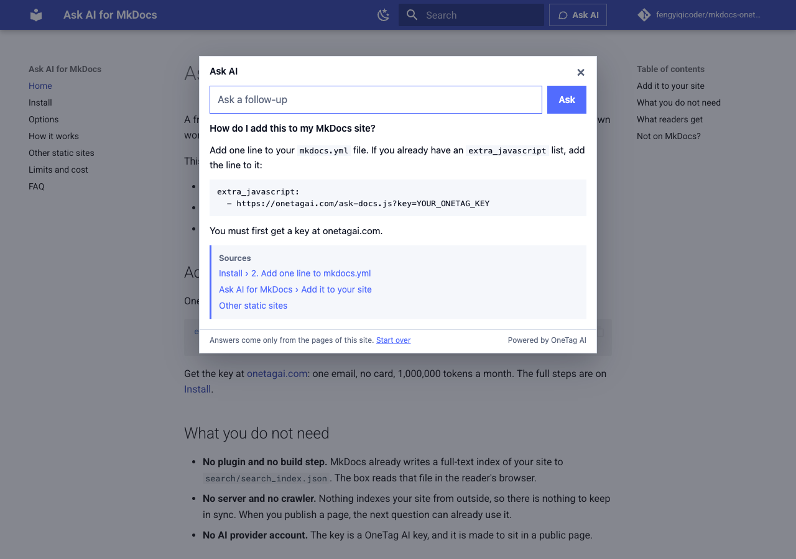

# Ask AI for MkDocs

A free Ask AI box for MkDocs and Material for MkDocs. Readers ask in their own words and get an answer written from your pages, with links to the pages it used.

**Live demo: [fengyiqicoder.github.io/mkdocs-onetag](https://fengyiqicoder.github.io/mkdocs-onetag/)**. Press **Ask AI** in the header.



## Install

One line in `mkdocs.yml`:

```yaml
extra_javascript:
  - https://onetagai.com/ask-docs.js?key=YOUR_ONETAG_KEY
```

Get the key at [onetagai.com](https://onetagai.com/?ref=mkdocs-onetag): one email, no card, 1,000,000 tokens, one time, no monthly reset. That is roughly 300 to 1,000 questions.

There is no plugin to install and nothing to build. MkDocs already writes a full-text index to `search/search_index.json`; the script reads it in the reader's browser, picks the sections that match the question and sends them to the AI with it. No server of yours, no crawler, no AI provider account.

## What it does

- Sits in the header next to search on Material for MkDocs, and floats in a corner on the built-in `mkdocs` and `readthedocs` themes. `Ctrl+/` opens it anywhere.
- Follows the theme's accent colour and its light and dark schemes.
- Answers in the language of the question, also when the docs are written in another one.
- Remembers the conversation for follow-up questions, and across page loads in the same tab.
- When the AI cannot answer, it still lists the matching pages, as plain search would.

Options (label, position, colour, your own button, your own instructions) are on the [Options](https://fengyiqicoder.github.io/mkdocs-onetag/options/) page.

## Not on MkDocs?

The same script works on Starlight and any site with a Pagefind index, on any site that publishes `llms-full.txt`, and on a single page: [Other static sites](https://fengyiqicoder.github.io/mkdocs-onetag/other-sites/).

## This repository

It is the demo site itself: `mkdocs.yml` and `docs/`. The script is [`sdk/ask-docs.js`](https://github.com/fengyiqicoder/onetagai/blob/main/sdk/ask-docs.js) in the OneTag AI repository, MIT licensed, with its tests next to it.

## License

MIT
